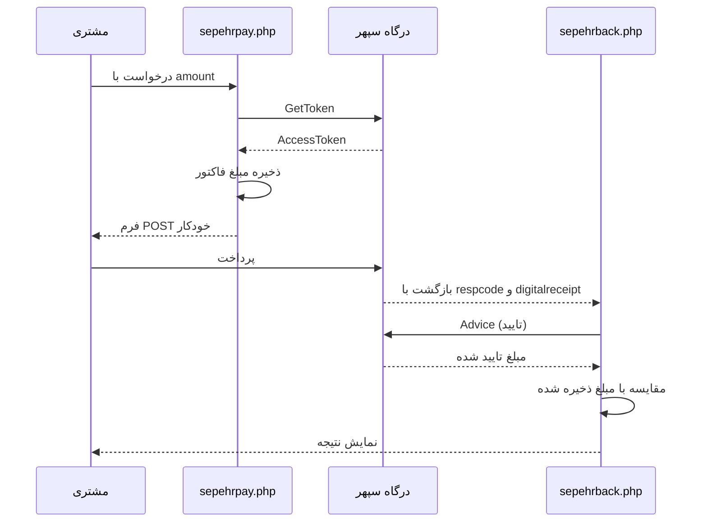

# درگاه پرداخت الکترونیک سپهر برای PHP 8.4


-0a58ca)

کلاس تمیز و مدرن PHP برای اتصال به **درگاه اینترنتی پرداخت الکترونیک سپهر (نسخه توکن)** بر اساس مستند رسمی نسخه `3.0.9`، به‌همراه دو صفحهٔ آمادهٔ **شروع پرداخت** و **بازگشت از درگاه** که فقط با تنظیم ترمینال کار می‌کنند.

> ⚠️ این پروژه غیررسمی است و وابسته به شرکت پرداخت الکترونیک سپهر نیست. قبل از استفاده در محیط واقعی حتما در محیط تست بررسی کنید.

---

## فهرست

- [امکانات](#امکانات)
- [پیش‌نیازها](#پیشنیازها)
- [ساختار فایل‌ها](#ساختار-فایلها)
- [نصب و راه‌اندازی](#نصب-و-راهاندازی)
- [تنظیمات](#تنظیمات)
- [استفاده سریع](#استفاده-سریع)
- [جریان پرداخت](#جریان-پرداخت)
- [استفاده از کلاس در کد خودتان](#استفاده-از-کلاس-در-کد-خودتان)
- [لیست متدها](#لیست-متدها)
- [کدهای خطا](#کدهای-خطا)
- [عیب‌یابی خطای IP (کد ۲-)](#عیبیابی-خطای-ip-کد-2-)
- [نکات امنیتی](#نکات-امنیتی)
- [ارتباط با ما](#ارتباط-با-ما)

---

## امکانات

- دریافت توکن برای همهٔ سرویس‌ها: **خرید، قبض، قبض گروهی، شارژ، بسته اینترنتی** و نسخه‌های «با شماره موبایل»
- هدایت مشتری به درگاه با فرم POST خودکار یا لینک GET (خرید معمولی، خرید شناسه‌دار، تطابق کد ملی و کارت)
- پردازش پاسخ بازگشتی با DTO تایپ‌شده (`SepehrCallback`)
- تایید تراکنش **Advice** و برگشت **Rollback** و **استعلام شارژ**
- فرایند کامل و امن `verifyPurchase` طبق نکات امنیتی مستند
- لیست بسته‌های اینترنتی (`GetDataPlanList`)
- **تسهیم** با مقدار متغیر (اندیس حساب یا شبا)
- چک سلامت سرویس (`CheckService`)
- ساخته‌شده با قابلیت‌های **PHP 8.4**: Enum، `readonly class`، Property Hooks، ثابت‌های typed، `array_find` / `array_any`
- اجبار IPv4 در ارتباط با سپهر و پشتیبانی از `bind IP` و `proxy` برای سرورهای چند-IP

---

## پیش‌نیازها

| مورد | توضیح |
|------|-------|
| PHP | نسخهٔ `8.4` یا بالاتر |
| افزونه‌ها | `curl` و `mbstring` |
| ترمینال | شمارهٔ ترمینال ۸ رقمی از پرداخت الکترونیک سپهر |
| IP سرور | باید قبلا در سپهر **ثبت** شده باشد (بدون آن خطای `-2` می‌گیرید) |
| دامنه | دامنهٔ `callbackURL` باید با دامنهٔ ثبت‌شده در قرارداد یکی باشد |

---

## ساختار فایل‌ها

```text
sepehr/
├── Sepehr.php          # کلاس اصلی درگاه (+ Enumها و DTOها)
├── sepehrconfig.php    # تنظیمات و توابع مشترک
├── sepehrpay.php       # شروع پرداخت (دریافت مبلغ با GET و رفتن به درگاه)
├── sepehrback.php      # صفحهٔ بازگشت؛ تایید و نمایش نتیجه
└── sepehrip.php        # (اختیاری) ابزار عیب‌یابی IP؛ بعد از استفاده حذف شود
```

> 💡 روی سرورهای لینوکسی نام فایل‌ها **حساس به حروف بزرگ و کوچک** است. کلاس اصلی باید دقیقا با نام `Sepehr.php` ذخیره شود.

---

## نصب و راه‌اندازی

```bash
git clone https://github.com/devmramirOrg/SepehrPaymentGateway.git
cd SepehrPaymentGateway
```

۱. فایل‌ها را روی هاست یا سرور خود (در یک پوشه) آپلود کنید.

۲. در `sepehrconfig.php` شمارهٔ ترمینال خود را بگذارید:

```php
const SEPEHR_TERMINAL_ID = '12345678';
```

۳. در پروداکشن آدرس بازگشت را ثابت کنید:

```php
const SEPEHR_CALLBACK_URL = 'https://yourdomain.ir/pay/sepehrback.php';
```

۴. IP سرور را به سپهر اعلام کنید (بخش [عیب‌یابی](#عیبیابی-خطای-ip-کد-2-) را ببینید).

۵. اطمینان دهید پوشهٔ پروژه دسترسی نوشتن دارد؛ فاکتورها در `sepehr_data/` ذخیره می‌شوند.

---

## تنظیمات

همهٔ تنظیمات در `sepehrconfig.php` هستند:

| ثابت | پیش‌فرض | توضیح |
|------|---------|-------|
| `SEPEHR_TERMINAL_ID` | `98000000` | شمارهٔ ترمینال ۸ رقمی (مقدار پیش‌فرض فقط نمونهٔ مستند است) |
| `SEPEHR_CALLBACK_URL` | `null` | آدرس کامل `sepehrback.php`؛ اگر `null` باشد از روی آدرس فعلی ساخته می‌شود |
| `SEPEHR_DATA_DIR` | `./sepehr_data` | پوشهٔ ذخیرهٔ فاکتورها و رسیدها (ترجیحا بیرون از وب‌روت) |
| `SEPEHR_MIN_AMOUNT` | `1000` | حداقل مبلغ مجاز (ریال) |
| `SEPEHR_BIND_IP` | `null` | IP ثبت‌شده در سپهر، برای سرورهای چند-IP |
| `SEPEHR_PROXY` | `null` | پراکسی/سرور واسط (مثلا `http://1.2.3.4:3128`) |

---

## استفاده سریع

مبلغ را **به ریال** با پارامتر `amount` بدهید:

```text
https://yourdomain.ir/sepehrpay.php?amount=50000
```

کاربر به درگاه سپهر منتقل می‌شود و بعد از پرداخت به `sepehrback.php` برمی‌گردد. آنجا یکی از نتایج زیر نمایش داده می‌شود:

- ✅ پرداخت موفق (به‌همراه شماره پیگیری، RRN، کارت ماسک‌شده، بانک و زمان)
- ⚠️ لغو توسط کاربر / اتمام زمان
- ❌ پرداخت ناموفق، مغایرت مبلغ یا رسید تکراری

اگر `amount` را ندهید، یک فرم ساده برای وارد کردن مبلغ نمایش داده می‌شود.

---

## جریان پرداخت



> تایید تراکنش (Advice) باید ظرف **۳۰ دقیقه** انجام شود؛ در غیر این صورت تراکنش خودکار برگشت می‌خورد. تراکنش‌های قبض و شارژ `AutoAdvice` هستند و نیازی به آن ندارند.

---

## استفاده از کلاس در کد خودتان

```php
<?php
require __DIR__ . '/Sepehr.php';

$sepehr = new Sepehr('98000000', 'https://yourdomain.ir/callback.php');
```

### خرید

```php
$token = $sepehr->purchaseToken(50000, 'INV-1001');
$sepehr->redirect($token); // فرم POST خودکار به درگاه
```

### پردازش بازگشت و تایید

```php
$cb  = $sepehr->parseCallback();
$res = $sepehr->verifyPurchase(
    $cb,
    50000, // مبلغ فاکتور در دیتابیس شما (ریال)
    fn (string $receipt): bool => false, // آیا این رسید قبلا ثبت شده؟
);

if ($res->success()) {
    // $cb->rrn ، $cb->traceNumber ، $cb->digitalReceipt را ذخیره و سفارش را نهایی کنید
} else {
    echo $res->status->value . ': ' . $res->message;
}
```

### پرداخت قبض

```php
$token = $sepehr->billToken(120000, 'BILL-1', '6605164900135', '2070394');
$sepehr->redirect($token, SepehrType::Bill);
```

### قبض گروهی (حداکثر ۱۰ قبض و سقف ۱,۰۰۰,۰۰۰ ریال)

```php
$token = $sepehr->batchBillToken(500000, 'BATCH-1', [
    ['BillID' => '6605164900135', 'PayID' => '2070394'],
    ['BillID' => '6605164900135', 'PayID' => '2070394'],
]);
$sepehr->redirect($token, SepehrType::BatchBill);
```

### شارژ

```php
$payload = $sepehr->buildChargePayload(
    '09121111111',
    Operator::Mci,
    ChargeType::Normal,
    RequestType::Topup,
);
$token = $sepehr->chargeToken(100000, 'CH-1', $payload);
$sepehr->redirect($token, SepehrType::Charge);
```

### بسته اینترنتی

```php
$list = $sepehr->getDataPlanList(DataPlanType::CreditAll, Operator::Mci, '09121111111');
$plan = $sepehr->findDataPlan($list['plans'], 123); // بر اساس ProfileId

$payload = $sepehr->buildChargePayload(
    '09121111111',
    Operator::Mci,
    ChargeType::Normal,
    RequestType::DataPlan,
    dataPlanId: 123,
    additionalData: $list['additionalData'], // مخصوص رایتل
);
$token = $sepehr->chargeToken(200000, 'DP-1', $payload);
$sepehr->redirect($token, SepehrType::Charge);
```

### تسهیم با مقدار متغیر (حداکثر ۹ حساب)

```php
$split = $sepehr->buildSplitByAccount([
    ['Account' => 'M01', 'Amount' => 7000],
    ['Account' => 'M02', 'Amount' => 8000],
], '0009');

$token = $sepehr->purchaseToken(15000, 'SPLIT-1', null, $split);

// یا با شبا (در ارسال هم‌زمان شبا و اندیس، شبا ملاک است)
$split = $sepehr->buildSplitByIban([
    ['Iban' => 'IR000000000000000000000000', 'Amount' => 1000],
], '00');
```

### خرید با شماره موبایل / شناسه‌دار

```php
$token = $sepehr->purchaseTokenByMobile(50000, 'INV-2', '09121234567');
$sepehr->redirect($token, SepehrType::MPay);

// خرید شناسه‌دار یا تطابق کد ملی با کارت
$sepehr->redirect($token, SepehrType::Pay, false, 'شناسه-پرداخت-یا-کد-ملی');
```

### Advice، Rollback و استعلام

```php
$advice = $sepehr->advice($digitalReceipt);
if ($advice->ok) {
    echo $advice->amount; // مبلغ تایید شده
} else {
    echo $advice->error;
}

$sepehr->rollback($digitalReceipt);   // نیازمند فعال بودن سرویس برگشت
$sepehr->inquiryCharge($rrn);         // استعلام شارژ
```

### چک سلامت سرویس

```php
var_dump($sepehr->checkService()); // ['token' => true, 'ui' => true, 'all' => true]
var_dump($sepehr->isServiceUp());
```

---

## لیست متدها

| متد | توضیح |
|-----|-------|
| `getToken()` | متد پایه دریافت توکن |
| `purchaseToken()` / `purchaseTokenByMobile()` | توکن خرید (ساده / با موبایل) |
| `billToken()` / `billTokenByMobile()` | توکن پرداخت قبض |
| `batchBillToken()` | توکن قبض گروهی |
| `chargeToken()` | توکن شارژ و بسته اینترنتی |
| `buildSplitByAccount()` / `buildSplitByIban()` | ساخت payload تسهیم |
| `buildBatchBillPayload()` / `buildChargePayload()` | ساخت payload قبض گروهی و شارژ |
| `paymentUrl()` | لینک GET پرداخت |
| `redirectForm()` / `redirect()` | فرم HTML هدایت / هدایت و پایان اسکریپت |
| `parseCallback()` | خواندن پاسخ بازگشتی به `SepehrCallback` |
| `verifyPurchase()` | فرایند کامل تایید خرید |
| `advice()` / `rollback()` | تایید و برگشت تراکنش |
| `inquiryCharge()` | استعلام شارژ با RRN |
| `getDataPlanList()` / `findDataPlan()` | لیست بسته‌ها و جستجوی بسته |
| `checkService()` / `isServiceUp()` | سلامت سرویس |
| `Sepehr::errorMessage()` | متن فارسی کد خطا |

**Enumها:** `SepehrType`، `Operator`، `ChargeType`، `RequestType`، `DataPlanType`، `CallbackStatus`، `VerifyStatus`

**نتیجهٔ `verifyPurchase`:** `Verified` ، `Canceled` ، `Timeout` ، `Failed` ، `Invalid` ، `DuplicateReceipt` ، `AdviceFailed` ، `AmountMismatch`

---

## کدهای خطا

| کد | توضیح |
|----|-------|
| `-1` | تراکنش پیدا نشد |
| `-2` | عدم تطابق IP / تراکنش قبلا Reverse شده |
| `-3` | خطای عمومی (Exception) |
| `-4` | امکان انجام درخواست نیست (عدم تطابق callback URL) |
| `-5` | آدرس IP نامعتبر (در لیست IPهای معرفی‌شده نیست) |
| `-6` | سرویس برگشت تراکنش برای پذیرنده فعال نیست |

در پاسخ بازگشتی (`respcode`): مقدار `0` موفق است، `-1` یعنی کاربر انصراف داده و `-2` یعنی زمان تراکنش تمام شده است.

---

## عیب‌یابی خطای IP (کد ۲-)

اگر هنگام دریافت توکن این خطا را گرفتید:

> عدم تطابق IP هنگام دریافت توکن / تراکنش قبلا Reverse شده است.

مشکل از کد نیست؛ **IP خروجی سرور شما در سپهر ثبت نشده است.** مراحل رفع:

1. فایل `sepehrip.php` را روی سرور باز کنید تا IP واقعی خروجی را ببینید.
2. همان IP (به‌صورت IPv4) را از طریق پرتال پذیرندگان یا واحد پذیرندگان اینترنتی سپهر ثبت کنید.
3. اگر هاست شما چند IP دارد، IP ثبت‌شده را در `SEPEHR_BIND_IP` بگذارید.
4. اگر سرور خارج از ایران است یا IP آن پذیرفته نمی‌شود، از یک سرور واسط ایرانی با IP ثابت استفاده کنید و آن را در `SEPEHR_PROXY` بگذارید.
5. اگر خطای `-4` گرفتید، دامنهٔ `SEPEHR_CALLBACK_URL` را با دامنهٔ ثبت‌شده در قرارداد یکسان کنید.
6. **بعد از رفع مشکل `sepehrip.php` را از سرور حذف کنید.**

---

## نکات امنیتی

- مبلغ فاکتور **سمت سرور** ذخیره می‌شود و فقط همان با مبلغ تاییدشدهٔ Advice مقایسه می‌شود؛ هرگز به مبلغ ارسالی از سمت کاربر اعتماد نکنید.
- رسید دیجیتال (`digitalreceipt`) برای هر تراکنش یکتاست و تکراری بودن آن بررسی می‌شود.
- سفارش را **فقط** بعد از `verifyPurchase` موفق نهایی کنید.
- پوشهٔ `sepehr_data` را بیرون از وب‌روت بگذارید و در گیت نگذارید. این خطوط را به `.gitignore` اضافه کنید:

  ```gitignore
  sepehr_data/
  ```

- شمارهٔ ترمینال واقعی و اطلاعات حساس را در مخزن عمومی کامیت نکنید.
- در محیط عمومی پیام خطاهای فنی را فقط لاگ کنید و به کاربر پیام کلی نشان دهید.
- اتصال به سپهر همیشه با `SSL verify` فعال انجام می‌شود؛ آن را غیرفعال نکنید.

---

## ارتباط با ما

<p>
  <a href="https://t.me/alacode">📢 کانال تلگرام ما</a>
  &nbsp;|&nbsp;
  <a href="https://t.me/devmramir">💬 پیوی ما</a>
  &nbsp;|&nbsp;
  <a href="https://alateam.ir">🌐 وبسایت ما</a>
</p>

- 📢 **کانال تلگرام ما:** [https://t.me/alacode](https://t.me/alacode)
- 💬 **پیوی ما:** [https://t.me/devmramir](https://t.me/devmramir)
- 🌐 **وبسایت ما:** [https://alateam.ir](https://alateam.ir)

اگر این پروژه برایتان مفید بود، ⭐ بدهید و برای گزارش مشکل از بخش **Issues** استفاده کنید.